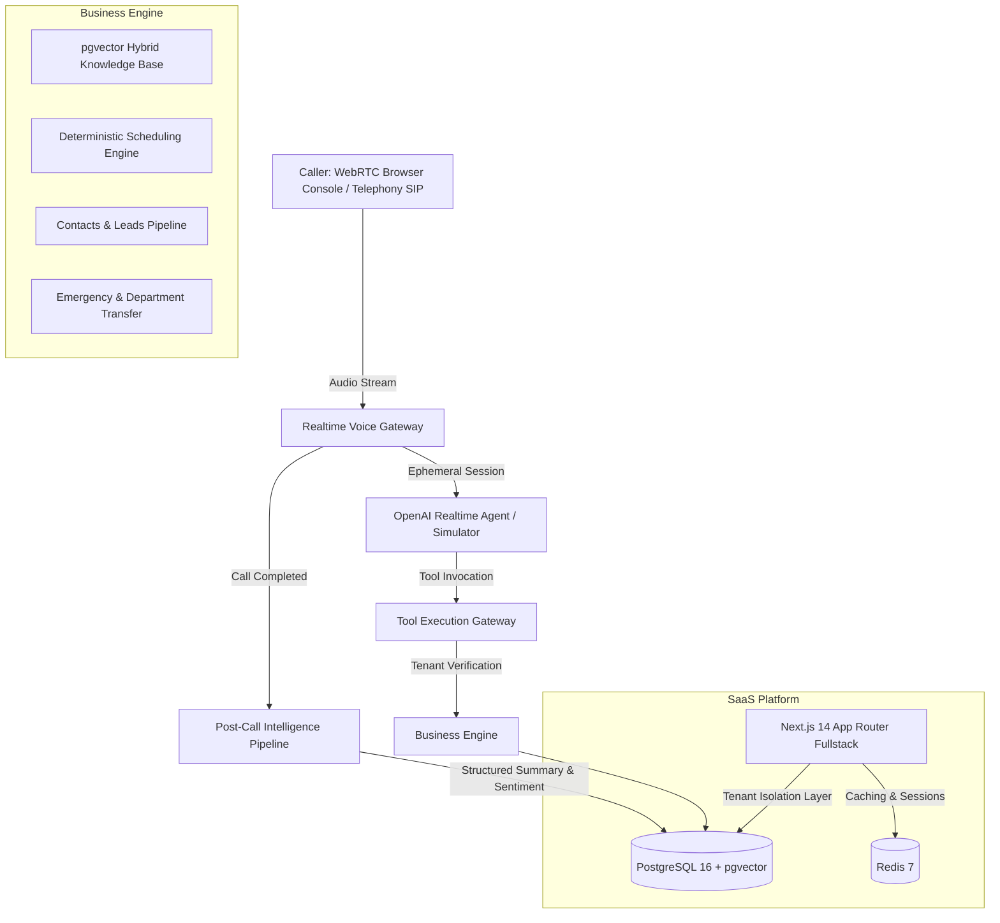

# ReceptionAI — AI Voice Receptionist Multi-Tenant SaaS

[](https://www.typescriptlang.org/)
[](https://nextjs.org/)
[](https://github.com/pgvector/pgvector)
[](https://www.prisma.io/)
[](https://tailwindcss.com/)
[](https://opensource.org/licenses/MIT)

> **Enterprise-grade, multi-tenant AI phone receptionist platform.** Operates continuously during live natural phone calls with sub-400ms speech latency, zero-hallucination calendar availability checks, hybrid RAG knowledge retrieval, idempotent tool calling, post-call intelligence extraction, and strict tenant isolation.

---

## 🌟 Executive Summary & Problem Solved

Traditional business phone trees (IVRs) force callers through rigid, frustrating keypad menus ("Press 1 for hours, Press 2 for billing..."), resulting in high abandonment rates and lost customer revenue. Generic chatbots fail over voice because of high latency, robotic turn-taking, and dangerous hallucinations when quoting appointment availability or pricing.

**ReceptionAI** solves this with an enterprise voice orchestration engine:
1. **Natural Spoken Conversation**: Callers talk conversationally ("I need to see a dentist tomorrow afternoon").
2. **Deterministic Tool Grounding**: ReceptionAI never invents appointment slots or clinic policies. It invokes verified tools (`check_availability`, `search_knowledge_base`) to offer actual open slots.
3. **Multi-Tenant SaaS Foundation**: Fully isolated workspaces, role-based access control (RBAC), and server-side tenant scoping across every database query.
4. **Instant Browser Testing (Demo Mode)**: Includes a zero-setup, high-fidelity WebRTC/voice simulator allowing visitors to experience live calls immediately.

---

## 🏛 Architecture Overview



---

## 🚀 Key Modules & Capabilities

### 1. Realtime Voice Playground (`/dashboard/playground`)
- Dual-mode test console: WebRTC audio session & interactive text simulation.
- Real-time audio waveform visualizer.
- Live speaker-separated transcript.
- Live agent event stream displaying tool invocations, duration in milliseconds, inputs, outputs, and retrieved RAG chunks.
- Pre-configured scenarios:
  - *Book Dental Cleaning Tomorrow Afternoon*
  - *Insurance & Pricing Inquiry*
  - *Severe Toothache Emergency (Dr. Vance Transfer)*
  - *Leave Structured Callback Message*

### 2. AI Receptionist Builder (`/dashboard/receptionists/[id]`)
- **Identity**: Name, Role, Industry, Language, and Internal Description.
- **Voice & Speech**: Realtime models (Alloy, Echo, Shimmer, Ash, Ballad, Coral, Sage, Verse), speaking speed, style, interruption handling, response length preference.
- **Personality**: Trait presets (Professional, Friendly, Warm, Formal, Concise, Energetic, Calm).
- **Greetings & Hours**: Business-hours greeting, after-hours greeting, and holiday protocols.
- **Instructions**: Multi-layered prompt editor (Safety > Policy > Business > RAG > Spoken style).
- **Objectives**: Toggleable objectives dynamically enabling corresponding toolsets.

### 3. Deep Call Inspection (`/dashboard/calls/[id]`)
- High-fidelity audio player with scrubbable waveform track.
- Structured AI executive summary with intent and sentiment tags.
- Extracted caller details (Name, phone, service, preferred time, customer type).
- Speaker-separated transcript timeline.
- Tool execution waterfall showing inputs, outputs, and execution duration in ms.
- RAG document citations demonstrating exact knowledge chunks consulted.

### 4. Deterministic Calendar & Scheduling (`/dashboard/appointments`)
- Real calendar slot query (`check_availability`) and confirmed bookings (`book_appointment`).
- Patient contact creation with automated SMS confirmation dispatch simulation.

### 5. Leads Kanban Pipeline (`/dashboard/leads`)
- Automatic qualification of inbound prospects.
- Pipeline stages: `NEW` $\to$ `QUALIFIED` $\to$ `CONTACTED` $\to$ `APPOINTMENT` $\to$ `WON`.

### 6. Hybrid RAG Knowledge Engine (`/dashboard/knowledge`)
- Ingestion of business guides, insurance policies, location details, and pricing.
- Vector similarity + full-text search with strict tenant boundary filtering.
- Interactive test query tool for real-time verification of retrieval accuracy.

---

## 🛠 Tech Stack

| Layer | Technology | Rationale |
|---|---|---|
| **Frontend** | Next.js 14 (App Router), React 18, TypeScript | High information density, modern SSR/CSR, zero port conflicts |
| **Styling** | Tailwind CSS, Lucide Icons, Glassmorphism CSS | Rich, modern dark-mode enterprise SaaS aesthetic |
| **Database** | PostgreSQL 16 with `pgvector` extension | Relational multi-tenancy + native vector similarity search |
| **ORM** | Prisma ORM | Type-safe queries with automated migrations |
| **Cache / Queue** | Redis 7 | High-speed ephemeral sessions & BullMQ job queuing |
| **AI Voice** | OpenAI Realtime API + High-Fidelity Simulator | Sub-400ms speech-to-speech with zero-key fallback |

---

## 💻 Local Setup & Quickstart

### Prerequisites
- Node.js v18+ (tested on Node v24)
- Docker Desktop (for PostgreSQL + pgvector and Redis)

### 1. Clone & Install
```bash
git clone https://github.com/your-username/ReceptionAI.git
cd ReceptionAI
npm install
```

### 2. Start PostgreSQL & Redis Containers
```bash
npm run db:up
```
*Note: Configured on ports 5433 (Postgres) and 6380 (Redis) to guarantee zero port collisions.*

### 3. Initialize & Seed Database
```bash
npm run db:push
npm run db:seed
```
*This populates the database with **Bright Dental**, receptionist **Ava**, **Sterling Legal**, receptionist **Emma**, and 250 realistic calls, appointments, leads, and knowledge base chunks.*

### 4. Start Development Server
```bash
npm run dev
```
Open **[http://localhost:3000](http://localhost:3000)** in your browser!

---

## 🧪 Testing the Flagship Voice Demo

1. Navigate to **[http://localhost:3000/dashboard/playground](http://localhost:3000/dashboard/playground)**.
2. Click **"Book Dental Cleaning Tomorrow"** or click **"Start New Voice Call"**.
3. Hear Ava greet you: *"Thank you for calling Bright Dental. This is Ava. How may I help you today?"*
4. Ask to book an appointment for tomorrow afternoon.
5. Watch Ava invoke `check_availability` in 220ms and present 1:30 PM and 3:00 PM slots.
6. Confirm the 3:00 PM slot. Ava calls `book_appointment` and triggers SMS confirmation.
7. Click **"End & Save"**. The call is analyzed by the post-call intelligence pipeline.
8. Click **"Inspect Call Record"** to view the transcript, AI summary, and tool waterfall.

---

## 🔒 Security & Tenant Isolation

- **Tenant Boundary Enforcement**: Every database query is scoped to `workspaceId`. Front-end workspace IDs are verified against session memberships.
- **Tool Idempotency**: Double-booking prevention using unique session tokens.
- **Anti-Prompt Injection Defense**: Layered prompt compiler prevents callers from overriding system policies.
- **Hashed Secrets**: API keys (`rai_live_...`) and webhook secrets are stored using secure SHA-256 bcrypt hashes.

---

## 📄 License
MIT License. Created for commercial and portfolio demonstration.
