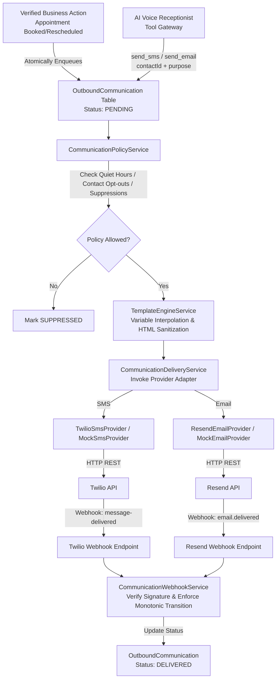

# Messaging & Notification Architecture (Phase 7)

## Overview

ReceptionAI provides reliable, policy-controlled transactional SMS and email messaging after verified business events (appointment bookings, reschedules, cancellations, callback requests, messages, and lead captures).

The messaging architecture is built around three core pillars:
1. **Strict Anti-Open-Relay Security**: The AI model is strictly prohibited from addressing communications to arbitrary phone numbers or email addresses, or injecting arbitrary raw message bodies. Recipients are bound to verified workspace Contacts, and templates are server-governed.
2. **Transactional Outbox & Delivery Reliability**: Business transactions atomically persist communication intents into PostgreSQL. An asynchronous delivery pipeline processes outbox records with exponential backoff retries, dead-letter recording, and provider independence.
3. **Monotonic Delivery Tracking & Webhook Ingestion**: Ingests cryptographic status callbacks from Twilio and Resend, strictly enforcing forward-only state progression (`PENDING` -> `QUEUED` -> `SENDING` -> `SENT` -> `DELIVERED` / `FAILED` / `SUPPRESSED`), while preventing out-of-order regressions.

---

## High-Level Component Flow

---

## Core Security & Reliability Guarantees

1. **Anti-Open-Relay**: AI callers cannot invoke `send_sms` or `send_email` with arbitrary `to`, `phone`, `email`, `body`, or `text`. Any attempt triggers an immediate `SECURITY_POLICY_VIOLATION`.
2. **Independent Failure Domain**: If a provider fails or network timeouts occur, the underlying appointment or business record remains valid. Outbound communications can be retried without modifying the appointment.
3. **Deterministic Idempotency**: Outbox items use deterministic keys (`appt_conf_<id>`, `appt_resched_<id>_<version>`, etc.) to prevent duplicate dispatches during network blips or retries.
4. **Monotonic Status Progression**: A late `SENT` webhook callback from a carrier will never overwrite a terminal `DELIVERED` status.
5. **Automatic Suppression**: If a recipient sends a STOP text (Twilio error 21610) or an email hard bounces, the address is automatically blacklisted in `CommunicationSuppression`.
