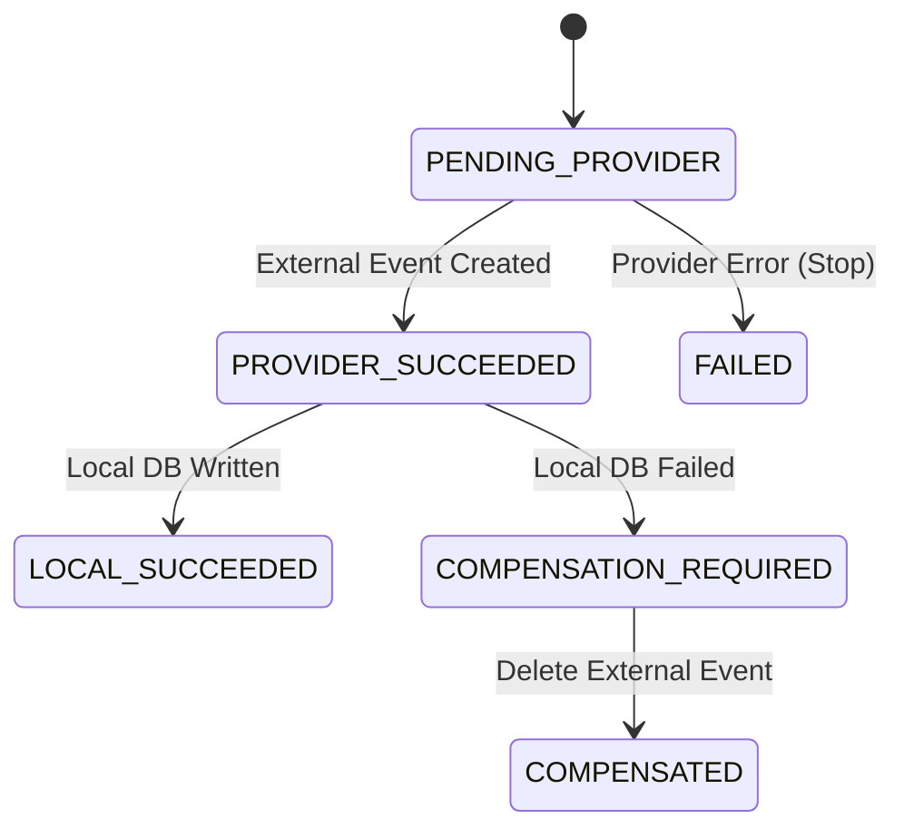

# Scheduling Sagas & Concurrency Control

## 1. Concurrency & Race Condition Prevention

In voice receptionist environments, two independent callers may be speaking to Ava at the exact same moment and choose the same 10:00 AM slot.

To prevent concurrent double-booking:
1. **Critical-Section Concurrency Lock**:
   * Before executing external provider writes, ReceptionAI acquires an atomic critical-section lock on the target slot key:
     `lock:slot:${workspaceId}:${calendarIntegrationId}:${startAt}`.
   * Only one execution thread enters the booking pipeline for that slot at a time.
2. **Revalidation Under Lock**:
   * Inside the lock, the engine queries the calendar provider's busy ranges.
   * If any booking exists spanning that window, the lock is released and the operation immediately throws `SLOT_NO_LONGER_AVAILABLE`.
3. **Database Unique Constraints**:
   * Even in multi-process clusters, PostgreSQL indexes and transactions enforce consistency across instances.

---

## 2. Two-Phase Booking Saga (`AppointmentOperation`)

Booking involves two heterogeneous systems:
1. External Calendar (Google Calendar API / Demo)
2. Local Database (PostgreSQL `Appointment` record)

To prevent orphaned bookings or inconsistent states, ReceptionAI executes a tracked two-phase saga using `AppointmentOperation`:

### Saga Stages:
1. **Operation Record Created**: A new `AppointmentOperation` is inserted with status `PENDING_PROVIDER` and operation type `BOOK`.
2. **Phase 1 (External Provider)**: The provider creates the event on Google Calendar and returns the external `eventId`. The operation updates to `PROVIDER_SUCCEEDED`.
3. **Phase 2 (Local Database)**: The local `Appointment` row is created within a Prisma transaction, alongside an immutable `AppointmentChange` entry. If successful, operation transitions to `LOCAL_SUCCEEDED`.
4. **Compensation on Failure**: If Phase 2 fails (e.g., database constraint or process restart), the saga enters `COMPENSATION_REQUIRED`. The engine immediately calls `provider.cancelAppointment()` to delete the orphaned Google Calendar event, and transitions the operation to `COMPENSATED`.
